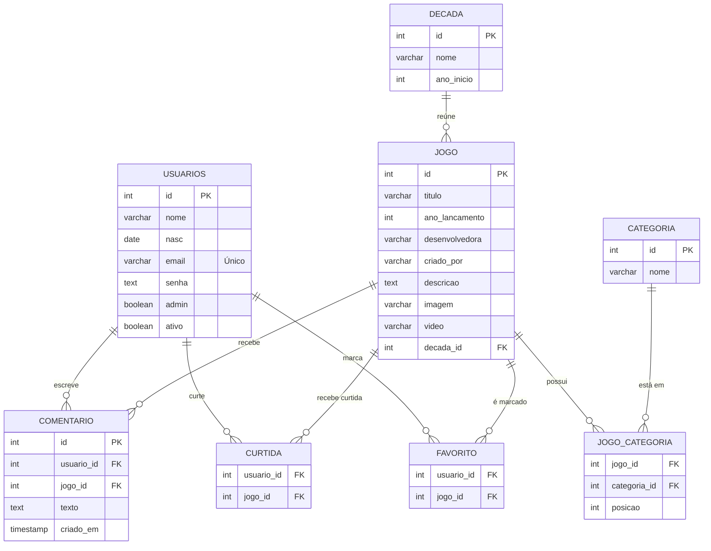

<div align="center">

# Game Erah

### Uma viagem pela evolução dos jogos, década por década


[Sobre](#sobre-o-projeto) · [Como rodar](#como-rodar-o-projeto) · [Estrutura](#estrutura-de-pastas) · [Requisitos](#requisitos) · [Banco de dados](#banco-de-dados) · [Diagramas](#diagramas)

</div>

---

<a name="sobre-o-projeto"></a>
## Sobre o projeto

O **Game Erah** é uma aplicação web feita em **PHP** com banco de dados **PostgreSQL** que conta a história dos videogames de um jeito simples e visual. Cada década tem seus jogos de destaque, e quem visita o site consegue ver como a tecnologia, os gráficos e a jogabilidade mudaram ao longo do tempo.

A plataforma tem dois tipos de acesso:

| Perfil | O que pode fazer |
|--------|------------------|
| **Visitante** | Navegar pelas décadas, consultar jogos com classificações por categoria e ver a ficha técnica |
| **Usuário cadastrado** | Tudo do visitante + curtir, favoritar jogos e enviar ou excluir seus próprios comentários |
| **Administrador** | Gerenciar (CRUD) usuários e jogos, visualizar painel com métricas e gerenciar comentários |

> [!NOTE]
> O CRUD completo (cadastrar, listar, atualizar e apagar) funciona integrado ao banco PostgreSQL, tanto para usuários quanto para os jogos e suas mídias.

---

## Índice

- [Sobre o projeto](#sobre-o-projeto)
- [Como rodar o projeto](#como-rodar-o-projeto)
  - [Pré-requisitos](#pré-requisitos)
  - [Passo a passo detalhado](#passo-a-passo-detalhado)
- [Estrutura de pastas](#estrutura-de-pastas)
- [Requisitos](#requisitos)
  - [Requisitos funcionais](#requisitos-funcionais)
  - [Requisitos não funcionais](#requisitos-não-funcionais)
  - [Regras de negócio](#regras-de-negócio)
- [O que o sistema faz](#o-que-o-sistema-faz)
- [Banco de dados](#banco-de-dados)
- [Diagramas](#diagramas)
- [Protótipos](#protótipos)
- [Como contribuir](#como-contribuir)
- [Contato](#contato)

---

<a name="como-rodar-o-projeto"></a>
## Como rodar o projeto

<a name="pre-requisitos"></a>
### Pré-requisitos

Antes de começar, confira se você tem na máquina:

- **PHP** com a extensão `pdo_pgsql` habilitada
- **PostgreSQL** instalado e rodando
- **Git**

<a name="passo-a-passo-detalhado"></a>
### Passo a passo detalhado

<details>
<summary><b>1️ Clonar o repositório</b></summary>

<br>

Abra o *Git Bash* e rode:

```bash
# Baixa o projeto do GitHub
git clone https://github.com/Livia-MP-Null/game_erah.git
# Entra na pasta do projeto
cd game_erah
```

</details>

<details>
<summary><b>2️ Criar o banco de dados</b></summary>

<br>

O arquivo SQL com toda a estrutura do banco fica na pasta `database`.

**a)** Abra o terminal e conecte no PostgreSQL com o usuário padrão:

```bash
psql -U postgres
```

**b)** Se já existir um banco de testes anterior, apague e crie de novo:

```sql
DROP DATABASE IF EXISTS dumpgameerahdb;
CREATE DATABASE dumpgameerahdb;
```

**c)** Crie um usuário exclusivo para o projeto e torne-o dono do banco:

```sql
CREATE USER game_erah WITH PASSWORD 'sua_senha';
ALTER DATABASE dumpgameerahdb OWNER TO game_erah;
\q
```

> [!TIP]
> No SQL, a senha vai entre **aspas simples** (`'sua_senha'`). Aspas duplas fazem o PostgreSQL entender como nome de coluna e dá erro.

**d)** Restaure as tabelas e os registros usando o arquivo de dump:

```bash
cd database
psql -U game_erah -h localhost -d dumpgameerahdb -f dumpGameErahDB.sql
cd ..
```

</details>

<details>
<summary><b>3️ Configurar a conexão no PHP</b></summary>

<br>

Abra o arquivo `database/connect.php` no VSCode e altere **somente** a senha:

```php
$host     = "localhost";      // não altere
$dbname   = "dumpgameerahdb";    // não altere
$user     = "game_erah";      // não altere
$password = "SUA_SENHA_AQUI"; // altere apenas este campo
```

</details>

<details>
<summary><b>4️ Abrir a aplicação</b></summary>

<br>

Na raiz do projeto, inicie o servidor embutido do PHP:

```bash


php -S localhost:8000
```

Pronto! Abra **http://localhost:8000** no navegador e aproveite.

</details>

---

<a name="estrutura-de-pastas"></a>
## 🗂️ Estrutura de pastas

```
game_erah
│   index.php               → página inicial
│   jogos.php               → seleção de décadas
│   decada.php              → exibição dos jogos da década
│   interagir.php           → processamento de curtidas, favoritos e comentários
│   README.md
├───app                     → área administrativa e CRUDs
│       create.php          → cadastro de usuário
│       select.php          → relatório de usuários
│       select_w.php        → consulta de usuário por ID
│       update.php          → atualização de usuário
│       delete.php          → exclusão de usuário
│       jogos_create.php    → cadastro de jogo
│       jogos_select.php    → relatório e lista de jogos
│       jogos_update.php    → edição de jogo
│       jogos_delete.php    → exclusão de jogo
│       painel.php          → dashboard do administrador
├───style                   → arquivos de estilo CSS
│       style.css
│       header.css
│       adm_style.css
│       jogos.css
├───database
│       connect.php         → conexão com o PostgreSQL
│       dumpgame_erahdb.sql → estrutura e dados do banco
├───includes
│       header.php          → cabeçalho reaproveitado
│       footer.php          → rodapé reaproveitado
│       functions.php       → funções gerais do sistema
│       functions_usuarios.php → funções do CRUD de usuários
│       functions_jogos.php    → funções do CRUD de jogos
│       functions_interacao.php→ funções de curtir, favoritar e comentar
│       botoes_decadas.php  → botões de seleção de décadas
│       view_decada.php     → visualização da página de década
└───login
        login.php
        cadastrar.php
        logout.php
```

---

<a name="requisitos"></a>
## Requisitos

<a name="requisitos-funcionais"></a>
### Requisitos funcionais

| ID | Título | Descrição | Prioridade |
|----|--------|-----------|:----------:|
| **RF01** | Cadastro de usuário | Permitir o registro de novos usuários | Alta |
| **RF02** | Relatório de usuários | Listar todos os usuários cadastrados na plataforma | Alta |
| **RF03** | Atualização de usuário | Permitir alterar dados e o estado do usuário | Alta |
| **RF04** | Exclusão de usuário | Permitir apagar o registro de um usuário com travas de segurança | Alta |
| **RF05** | Consulta de usuário | Exibir as informações de um usuário a partir do seu ID | Alta |
| **RF06** | Linha do tempo por décadas | Permitir navegar pela história dos jogos dividida em décadas | Alta |
| **RF07** | Classificação por categoria | Exibir selos de classificação e posição do jogo em cada categoria | Média |
| **RF08** | Ficha técnica do jogo | Exibir detalhes do jogo com ano, desenvolvedora, autor, imagem, vídeo e descrição | Média |
| **RF09** | Painel administrativo | Permitir que administradores gerenciem jogos, usuários e visualizem métricas do sistema | Média |
| **RF10** | Curtir e Favoritar jogo | Permitir que o usuário logado curta e favorite/desfavorite jogos | Média |
| **RF11** | Comentar jogo | Permitir que o usuário logado envie e exclua comentários na página do jogo | Média |

<a name="requisitos-nao-funcionais"></a>
### Requisitos não funcionais

| ID | Título | Descrição | Prioridade |
|----|--------|-----------|:----------:|
| **RNF01** | Responsividade | A interface deve funcionar bem em celulares, tablets e computadores | Média |
| **RNF02** | Desempenho de mídia | Fazer upload e exibição otimizada de imagens e vídeos | Média |
| **RNF03** | Estética e design | Visual temático inspirado na cultura gamer, com modo escuro e barras personalizadas | Baixa |
| **RNF04** | Segurança | Usar *prepared statements* no banco, `password_hash()` para senhas, validação CSRF e sanitização contra XSS | Alta |

<a name="regras-de-negocio"></a>
### Regras de negócio

| ID | Regra | Descrição |
|----|-------|-----------|
| **RN01** | E-mail único | Não é permitido cadastrar dois usuários com o mesmo e-mail |
| **RN02** | Acesso do administrador | Somente administradores acessam o painel e os CRUDs |
| **RN03** | Autoexclusão e último admin | O administrador não pode apagar a própria conta nem remover o último admin |
| **RN04** | Login para interagir | Curtir, favoritar e comentar exigem sessão ativa de usuário |
| **RN05** | Alternância de marcação | Curtir e favoritar funcionam no formato *toggle* (liga/desliga) |
| **RN06** | Exclusão de comentários | O usuário só pode apagar os próprios comentários, enquanto administradores podem apagar qualquer comentário |

---

<a name="o-que-o-sistema-faz"></a>
##  O que o sistema faz

| # | Ação | Quem pode | Exige login? |
|---|------|-----------|:------------:|
| 1 | Criar conta de usuário | Qualquer pessoa | Não |
| 2 | Excluir usuário | Administrador | Sim |
| 3 | Consultar todos os usuários | Administrador | Sim |
| 4 | Consultar um usuário específico | Administrador | Sim |
| 5 | Atualizar cadastro de usuário | Administrador | Sim |
| 6 | Consultar jogos por década e classificação | Qualquer pessoa | Não |
| 7 | Ver detalhes e mídias de um jogo | Qualquer pessoa | Não |
| 8 | Favoritar um jogo | Usuário cadastrado | Sim |
| 9 | Curtir um jogo | Usuário cadastrado | Sim |
| 10 | Enviar e apagar comentário sobre um jogo | Usuário cadastrado / Admin | Sim |

---

<a name="banco-de-dados"></a>
## Banco de dados

### `usuarios`

| Campo | Tipo | Restrições | Descrição |
| ----- | ---- | ---------- | --------- |
| id | SERIAL | PRIMARY KEY | Identificador do usuário |
| nome | VARCHAR(100) | NOT NULL | Nome do usuário |
| nasc | DATE | — | Data de nascimento |
| email | VARCHAR(255) | UNIQUE, NOT NULL | E-mail para login |
| senha | TEXT | NOT NULL | Senha criptografada |
| admin | BOOLEAN | NOT NULL, DEFAULT `false` | Define se o usuário é administrador |
| ativo | BOOLEAN | NOT NULL, DEFAULT `true` | Estado do usuário (ativo/inativo) |

### `decada`

| Campo | Tipo | Restrições | Descrição |
| ----- | ---- | ---------- | --------- |
| id | SERIAL | PRIMARY KEY | Identificador da década |
| nome | VARCHAR(50) | UNIQUE, NOT NULL | Nome da década (ex.: "Anos 80") |
| ano_inicio | INT | NOT NULL | Ano inicial da década (ex.: 1980) |

### `categoria`

| Campo | Tipo | Restrições | Descrição |
| ----- | ---- | ---------- | --------- |
| id | SERIAL | PRIMARY KEY | Identificador da categoria |
| nome | VARCHAR(60) | UNIQUE, NOT NULL | Nome da categoria (ex.: "Mais jogados") |

### `jogo`

| Campo | Tipo | Restrições | Descrição |
| ----- | ---- | ---------- | --------- |
| id | SERIAL | PRIMARY KEY | Identificador do jogo |
| titulo | VARCHAR(150) | NOT NULL | Nome do jogo |
| ano_lancamento | INT | NOT NULL | Ano de lançamento |
| desenvolvedora | VARCHAR(100) | — | Empresa desenvolvedora |
| criado_por | VARCHAR(100) | — | Autor/Criador do jogo |
| descricao | TEXT | — | Descrição detalhada |
| imagem | VARCHAR(255) | — | Nome do arquivo de imagem salvo no servidor |
| video | VARCHAR(255) | — | Nome do arquivo de vídeo salvo no servidor |
| decada_id | INT | FOREIGN KEY → decada.id | Década do jogo |

### `jogo_categoria`

| Campo | Tipo | Restrições | Descrição |
| ----- | ---- | ---------- | --------- |
| jogo_id | INT | FOREIGN KEY → jogo.id | Jogo relacionado |
| categoria_id | INT | FOREIGN KEY → categoria.id | Categoria relacionada |
| posicao | INT | NOT NULL | Posição/ranking do jogo na categoria (ex.: 1º lugar) |

**Chave primária:** (jogo_id, categoria_id)

### `favorito`

| Campo | Tipo | Restrições | Descrição |
| ----- | ---- | ---------- | --------- |
| usuario_id | INT | FOREIGN KEY → usuarios.id | Usuário que favoritou |
| jogo_id | INT | FOREIGN KEY → jogo.id | Jogo favoritado |

**Chave primária:** (usuario_id, jogo_id)

### `curtida`

| Campo | Tipo | Restrições | Descrição |
| ----- | ---- | ---------- | --------- |
| usuario_id | INT | FOREIGN KEY → usuarios.id | Usuário que curtiu |
| jogo_id | INT | FOREIGN KEY → jogo.id | Jogo curtido |

**Chave primária:** (usuario_id, jogo_id)

### `comentario`

| Campo | Tipo | Restrições | Descrição |
| ----- | ---- | ---------- | --------- |
| id | SERIAL | PRIMARY KEY | Identificador do comentário |
| usuario_id | INT | FOREIGN KEY → usuarios.id | Autor do comentário |
| jogo_id | INT | FOREIGN KEY → jogo.id | Jogo comentado |
| texto | TEXT | NOT NULL | Conteúdo do comentário |
| criado_em | TIMESTAMP | DEFAULT CURRENT_TIMESTAMP | Data e hora de publicação |

---

<a name="diagramas"></a>
##  Diagramas

### Modelo Entidade-Relacionamento



---

<a name="prototipos"></a>
## Protótipos

**Baixa fidelidade:** 

**Alta fidelidade:** [Clique aqui para ver no Figma](https://www.figma.com/design/ADrwIyHNxIPXHmH4bonXNR/E-Learning-Site--Community-?node-id=0-1&t=kyFfQaBdBLAscwWi-1)

---

<a name="como-contribuir"></a>
## Como contribuir

1. Faça um **fork** do projeto
2. Crie uma branch para sua ideia
   ```bash
   git checkout -b feature/minha-ideia
   ```
3. Salve suas mudanças
   ```bash
   git commit -m "Adiciona minha ideia"
   ```
4. Envie para o seu fork
   ```bash
   git push origin feature/minha-ideia
   ```
5. Abra um **Pull Request**

---

<a name="contato"></a>
## Contato

- **Autora:** Livia
- **GitHub:** [@Livia-MP-Null](https://github.com/Livia-MP-Null)

<div align="center">

Feito com 💜 para quem ama jogos.

</div>
